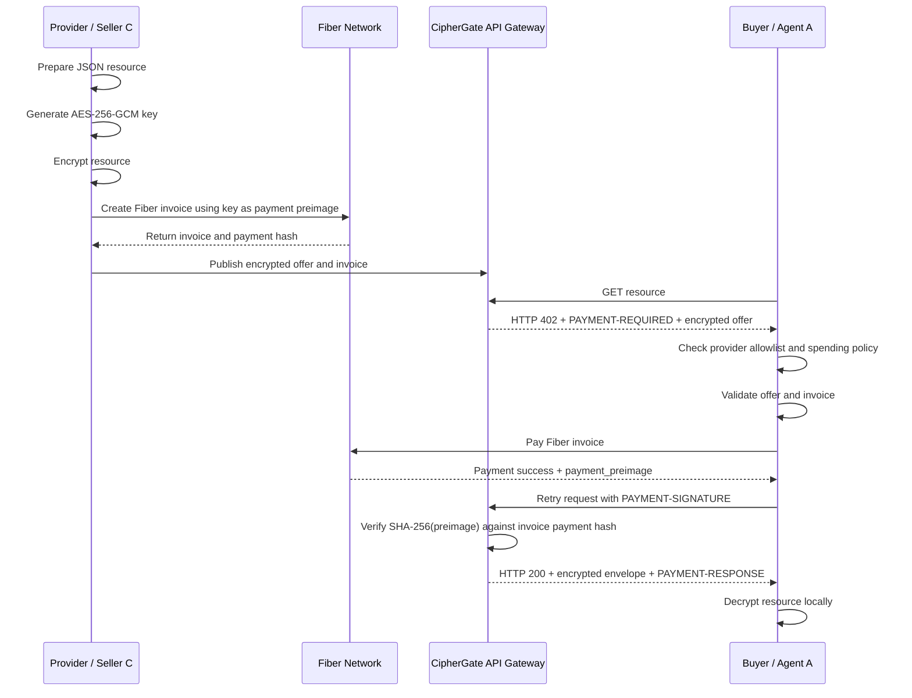
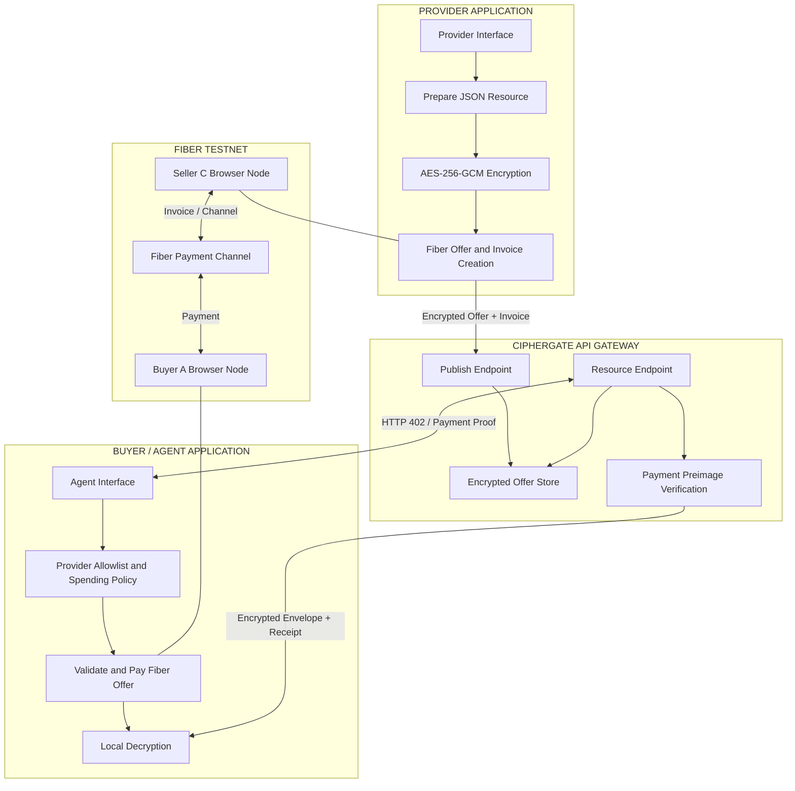

# CipherGate
### Pay for Data. Unlock with Payment.

**CipherGate is a payment-gated API delivery prototype built on Fiber Network. It enables developers to publish encrypted digital resources and allows buyers or AI agents acting on their behalf to pay a Fiber invoice before obtaining the cryptographic material required to decrypt those resources.**

Instead of treating payment and access as two loosely connected application steps, CipherGate connects them cryptographically: the AES-256-GCM encryption key is used as the Fiber invoice payment preimage. When the buyer completes the payment, the Fiber payment result returns that preimage. The buyer can then decrypt the resource locally.

CipherGate extends the official Fiber encrypted-data-payment starter into a practical developer use case: **paid API responses and machine-to-machine data commerce.**

> **The core idea:** A resource is encrypted before it is offered. Payment is not simply a database flag indicating that access has been granted. The payment preimage is the key material required to unlock the content.

---

## 1. The Problem We're Exploring

APIs, datasets, research reports, premium data feeds, and generated outputs have economic value. Developers need ways to charge for access to these resources, but common approaches introduce friction.

- **API keys and account creation:** These create onboarding and credential-management overhead.
- **Subscription plans:** Consumers may need to commit to an ongoing subscription even when they only need one specific resource.
- **Traditional per-request billing:** Access often depends on a trusted application server recording usage, updating balances, and deciding whether to return a response.
- **Agent payment limitations:** Software agents need a way to discover a resource, evaluate its price, pay for it, and continue their tasks without requiring a person to manually complete checkout.

CipherGate explores a different interaction:

**Request a resource → Receive its payment requirement → Evaluate the price → Pay for that resource → Unlock the encrypted content.**

This is particularly interesting for agent-oriented applications. An agent may need one report, one data point, or one API response—not an ongoing subscription.

A payment-per-resource model gives the application a clear unit of purchase and gives the provider a way to attach a price to that unit.

CipherGate is a prototype of this interaction, not a claim that every API or agent should replace its existing authentication and billing systems.

## 2. What CipherGate Does

CipherGate introduces three main roles:

1. **Provider:** Prepares a resource, encrypts it, creates a Fiber Testnet invoice, and publishes the encrypted offer.
2. **Gateway:** Exposes the resource endpoint, communicates the payment requirement, checks the submitted preimage against the invoice payment hash, and returns the encrypted envelope after a matching proof.
3. **Buyer / Agent:** Requests the resource, evaluates the payment requirement against a spending policy, pays the Fiber invoice, submits the payment proof, and decrypts the resource locally.

The current demo uses structured JSON as its resource format. The sample research content is illustrative; it is not generated by an AI model and is not verified market research.

### The payment-to-decryption flow

The complete interaction follows this sequence:



The important cryptographic relationship is:

```text
AES-256-GCM key = Fiber invoice payment preimage

SHA-256(payment preimage) = invoice payment hash
```

The encryption key is not sent to the buyer before payment. The buyer obtains the preimage from the successful Fiber payment result and uses it as the key to decrypt the resource.

---

## 3. System Architecture

CipherGate is deliberately built as an extension of the existing Fiber encrypted-data-payment application rather than a replacement implementation.

We retained the original Fiber browser-node, channel, invoice, offer, payment, and decryption foundations, then introduced a provider publishing flow, an HTTP resource gateway, and an agent purchasing flow.

### 3.1 High-level architecture



### 3.2 Architecture layers

| Layer | Location | Responsibility |
|---|---|---|
| Provider experience | `app/ciphergate/provider/page.tsx` | Starts Seller C, opens or reuses the channel, prepares JSON, creates the encrypted offer and invoice, and publishes it. |
| Agent experience | `app/ciphergate/agent/page.tsx` | Starts Buyer A, requests the resource, presents the payment requirement, applies spending policy, pays, and decrypts. |
| Publish API | `app/api/ciphergate/publish/route.ts` | Accepts and publishes the provider's encrypted offer. |
| Resource API | `app/api/ciphergate/resources/[slug]/route.ts` | Returns the payment requirement or processes a submitted payment proof and returns the encrypted envelope. |
| Agent client | `lib/ciphergate/agent-client.ts` | Coordinates the agent-side request, payment-proof submission, and resource retrieval. |
| Spending policy | `lib/ciphergate/policy.ts` | Applies the demo's provider allowlist and spending constraints before payment. |
| Offer store | `lib/ciphergate/store.ts` | Holds published offers and their consumption state in process memory. |
| Protocol types | `lib/ciphergate/types.ts` | Defines the data structures used by the CipherGate flow. |
| x402-style transport | `lib/ciphergate/x402.ts` | Encodes and parses payment requirements, payment proofs, and payment response headers. |

### 3.3 Provider layer

The provider is responsible for making a resource available for purchase.

Its responsibilities include:

- Starting the Seller C browser Fiber node.
- Opening or reusing the Bottle payment channel.
- Preparing the JSON resource.
- Encrypting the resource using AES-256-GCM.
- Creating a Fiber invoice whose payment preimage is the encryption key.
- Publishing the encrypted offer and invoice to the CipherGate gateway.

The provider does not publish the plaintext resource as part of the offer.

### 3.4 Gateway layer

The gateway acts as the HTTP interface between resource providers and buyers.

It is responsible for:

- Publishing and retrieving encrypted offers.
- Returning HTTP 402 when a payment is required.
- Communicating payment requirements through x402 V2-style headers.
- Processing submitted payment proofs.
- Checking invoice and payment-preimage relationships.
- Marking an offer as consumed after a matching proof.
- Returning the encrypted resource envelope and payment response.

The gateway does not perform the buyer's local decryption.

### 3.5 Agent layer

The agent represents a software consumer purchasing a resource.

It is responsible for:

- Starting the Buyer A browser Fiber node.
- Requesting a published resource.
- Reading the payment requirement.
- Checking provider permissions and spending constraints.
- Validating the offer and invoice.
- Paying through Fiber.
- Retrieving the payment preimage.
- Submitting payment proof to the gateway.
- Decrypting the purchased resource locally.

This architecture creates a clear separation between the party selling data, the service coordinating access, and the party purchasing it.

---

## 4. Why We Made These Design Decisions

CipherGate is intentionally small enough to demonstrate end-to-end, but each architectural choice serves a specific purpose.

### 4.1 We built on the official Fiber starter instead of rebuilding payment infrastructure

The purpose of this project is to demonstrate a new use case for Fiber—not to reproduce the underlying payment implementation.

The official starter already provides:

- Browser-based Fiber node integration.
- Channel setup and management.
- Invoice and offer handling.
- Payment execution and recovery.
- Payment-preimage retrieval.
- Resource decryption.

Reusing those components keeps the project focused on the application-level problem: how a developer can package a digital resource as a payment-gated API.

It also preserves the Advanced quest's central requirement: **the payment preimage unlocks the encrypted content.**

The new work is the provider, gateway, and agent experience around that mechanism.

### 4.2 We chose paid API resources as the use case

A paid API resource is a natural fit for payment-triggered decryption.

An API response is a discrete unit of value: a report, a dataset slice, a premium response, or a generated artifact.

That makes the relationship between price and access easy to demonstrate. A provider publishes one resource with one invoice; a buyer requests that resource and pays for it.

This is more concrete than demonstrating a generic wallet transfer because the payment has a direct application-level outcome.

It also creates an interesting direction for agent-based software. Agents increasingly need to consume services and data from other services. A payment-gated resource gives an agent a clear:

**Request → Quote → Policy Check → Payment → Result**

workflow.

### 4.3 We used AES-256-GCM and tied the key to the invoice preimage

Encryption is the core of the project, not a decorative step after payment.

AES-GCM provides authenticated encryption: the buyer needs the correct key to recover the plaintext and verify the encrypted payload's integrity.

By using the encryption key as the Fiber invoice preimage, the payment and decryption steps become connected.

A successful payment returns the preimage. The buyer can then use it as the key to decrypt.

This demonstrates a stronger relationship than simply checking a boolean such as `paid: true` before returning an unencrypted response.

### 4.4 We introduced an HTTP 402 payment challenge

An API needs a way to tell a caller that a resource exists but requires payment.

HTTP 402 provides a recognizable payment-required response.

CipherGate uses x402 V2-style headers to carry the payment requirement and subsequent proof in the HTTP exchange.

This keeps the interaction close to familiar API request/response patterns instead of requiring the buyer to understand a custom sequence of unrelated UI actions.

The implementation is Fiber-specific and experimental. It uses the x402 V2 header format with a `fiber:testnet` exact-payment requirement and an invoice/preimage proof shape. It should not be described as complete or officially certified x402 facilitator support.

### 4.5 We separated provider, gateway, and buyer responsibilities

The provider creates and prices the resource. The gateway publishes the offer and checks the submitted proof. The buyer decides whether to pay and performs decryption.

That separation makes the flow easier to reason about and provides a path toward future integrations:

- A provider could expose resources from an existing API.
- A gateway could handle payment challenges.
- An agent SDK could handle policy and payment.

In this prototype, these are logical application boundaries inside one Next.js project, not separately deployed production services.

### 4.6 We added a spending policy before the agent pays

An agent that can spend money needs boundaries.

The demo includes a provider allowlist and spending constraints so the buyer-side flow has an explicit decision point before it pays.

This is important to the product direction: agent payments should be policy-driven, not blind.

The current policy is enforced in the demo client, so it is a prototype safeguard rather than a security boundary against a malicious or modified client.

### 4.7 We made the resource single-use in the demo

Each published offer is associated with one invoice and is marked consumed after a matching proof is accepted.

This keeps the demo's purchase lifecycle understandable and prevents the same in-memory offer from being used repeatedly through the intended application flow.

A real service would need durable records, concurrency-safe state transitions, and a clear policy for retries, refunds, and repeated purchases.

### 4.8 We kept the demo focused on the end-to-end path

We did not add a large analytics dashboard, account system, or unrelated marketplace features.

The goal is to make the core interaction visible and testable:

**Publish an encrypted resource → Request it → Receive a payment challenge → Pay through Fiber → Decrypt the content.**

That focus keeps attention on the innovation being explored:

**Payment as the event that provides the cryptographic capability to unlock a resource.**

---

## 5. Technology Stack and Fiber Integration

| Technology | Purpose |
|---|---|
| Fiber Network | Payment infrastructure used by Seller C and Buyer A. |
| Fiber Testnet | Network used for the demonstration. |
| AES-256-GCM | Encrypts the provider's JSON resource. |
| Next.js | Provider and agent interfaces, plus API routes. |
| TypeScript | Application logic and type safety. |
| HTTP 402 | Communicates that a resource requires payment. |
| x402 V2-style headers | Carries payment requirements and submitted payment proof. |
| Browser cryptography | Supports the cryptographic workflow provided by the starter. |
| Fiber browser SDK | Connects the application to browser-based Fiber nodes. |

### Existing starter code reused

CipherGate retains and builds on these original modules:

- `startRole`, `connectAndOpenChannel`, `readChannel`, and `ready` from `lib/fiber.ts`.
- `createOffer` and `parseOffer` from `lib/offer.ts`.
- `validateOffer` and `payForOffer` from `lib/payment.ts`.
- `decryptResult` from `lib/crypto.ts`.
- `createBrowserNodeSession` from `lib/node-session.ts`.
- `encryptedBuyerProfile` and `encryptedSellerProfile` from `lib/progress.ts`.

**This is an extension, not a replacement starter.**

Keep the original starter files, dependency versions, and Next.js cross-origin isolation headers. The extension does not require additional npm packages.

---

## 6. Getting Started

### Requirements

- Node.js **22.18 or newer**, as required by the official starter.
- The official Fiber encrypted-data-payment starter project.
- A browser that supports the starter's browser-node requirements.
- Fiber Testnet access.
- The ability to fund the displayed testnet addresses when a channel needs to be opened.

### Installation

Start from the official starter directory after merging the CipherGate extension files into its root.

Install dependencies:

```bash
npm install
```

Run the available project checks:

```bash
npm run typecheck
npm test
npm run build
```

Start the development server:

```bash
npm run dev
```

Keep the starter's Next.js cross-origin isolation headers.

The browser-node workflow depends on browser capabilities such as cross-origin isolation, SharedArrayBuffer, and Web Locks. Use the same browser and `localhost:3001` origin for both roles.

### Open the application

**Provider**

http://localhost:3001/ciphergate/provider

**Agent**

http://localhost:3001/ciphergate/agent

---

## 7. End-to-End Demo

The demo follows the complete encrypted-resource purchase lifecycle.

### Step 1: Start the provider

1. Open the Provider page.
2. Select **Start Seller C**.
3. Select **Open / reuse Bottle channel**.
4. If the channel from the Basic tutorial is already ready, it can be reused.
5. Otherwise, fund Seller C's displayed address and wait for `CHANNEL_READY`.

### Step 2: Publish an encrypted resource

1. Edit the sample JSON resource if desired.
2. Select **Encrypt JSON + create 1 CKB invoice + publish**.
3. The provider encrypts the JSON using AES-256-GCM.
4. The Fiber invoice is created with the encryption key as its payment preimage.
5. CipherGate publishes the encrypted offer and invoice.

### Step 3: Start the buyer / agent

1. Open the Agent page in a second tab.
2. Select **Start Buyer A**.
3. Select **Open / reuse Bottle channel**.
4. Reuse the channel from Basic if it is ready.
5. Otherwise, fund Buyer A's displayed address and wait for `CHANNEL_READY`.

### Step 4: Request the resource

1. Select **Request resource**.
2. The agent requests the published resource from the gateway.
3. The gateway responds with HTTP 402.
4. The agent displays the public preview, encrypted offer, and invoice details.

### Step 5: Approve and pay

1. Review the payment requirement and spending policy.
2. Select **Approve policy + pay 1 CKB + decrypt**.
3. The buyer pays the Fiber invoice.
4. Wait for Fiber payment success.
5. The buyer receives the payment preimage.

### Step 6: Submit proof and decrypt

1. The agent submits the payment proof using `PAYMENT-SIGNATURE`.
2. The gateway checks the preimage/payment-hash relationship.
3. The gateway returns the encrypted resource envelope and a `PAYMENT-RESPONSE` receipt.
4. The agent decrypts the JSON locally using the payment preimage.

**Browser note:** Keep one active tab per saved Fiber node. Seller C and Buyer A use different saved node profiles, so the provider and agent can run in separate tabs. Close the original tutorial tab if it has already started the same saved node; the starter uses Web Locks to prevent the same saved node from running in multiple tabs.

---

## 8. API Contract

### `GET /api/ciphergate/resources/:slug`

This endpoint supports two stages of the resource-purchase flow.

### Without `PAYMENT-SIGNATURE`

The gateway responds with:

- HTTP `402 Payment Required`.
- A base64-encoded x402 V2-style `PAYMENT-REQUIRED` header.
- A public preview.
- The encrypted offer envelope.

The encrypted envelope can be exposed without revealing the plaintext, assuming the encryption key remains secret.

### With `PAYMENT-SIGNATURE`

The request includes a base64-encoded x402 V2-style proof containing the Fiber invoice and payment preimage.

The gateway checks:

- The selected scheme, network, and asset.
- The fixed 1 CKB amount and seller public key.
- The resource ID, invoice, and payment-hash relationship.
- That SHA-256 of the supplied payment preimage matches the invoice payment hash.

If the checks match, the gateway returns HTTP `200`, the encrypted resource envelope, and a `PAYMENT-RESPONSE` header.

The agent then decrypts the resource locally.

Each published offer is single-use in this demo. Publish a fresh offer and invoice for another purchase.

---

## 9. Security Model and Current Limitations

CipherGate is a **local Fiber Testnet hackathon prototype**, not a production payment facilitator.

The distinction matters.

### Invoice settlement verification

The browser agent uses the real Fiber Testnet node and the starter's payment result to obtain the preimage.

The gateway independently checks the preimage/hash binding, but it does not connect to Seller C's Fiber node to query `get_invoice` status.

A production gateway must independently reconcile the merchant invoice state—or use a properly configured facilitator—before issuing a final settlement receipt.

### Receipt identifier

The `transaction` string in the demo `PAYMENT-RESPONSE` is a deterministic receipt reference, not a CKB layer-1 transaction hash.

Fiber payments are channel payments.

### In-memory storage

Published resource records are held in a process-local in-memory `Map`.

Restarting the Next.js server clears them. A multi-instance deployment needs durable storage and atomic payment/receipt state.

### Spending policy location

The demo agent enforces its allowlist and spending policy client-side.

A production agent SDK should persist budget usage in a trusted store and enforce limits at the payment boundary so a compromised client cannot bypass policy.

### x402 compatibility

The project uses x402 V2-style HTTP headers with a Fiber-specific `fiber:testnet` exact-payment requirement and invoice/preimage proof shape.

It should not be represented as full x402 facilitator compliance. Do not assume every Fiber node exposes facilitator endpoints.

### Resource content

The sample JSON research content is illustrative. It is not generated by an AI model and is not verified market research.

### Deployment model

Provider, gateway, and buyer are logical boundaries in one Next.js application for the demo.

They are not independently deployed or hardened production services.

These limitations are documented intentionally. They identify what the prototype demonstrates today and what would need to change before handling real customer data or real-value payments.

---

## 10. What We'd Build Next

The prototype establishes the payment-to-decryption path.

The next engineering steps would be:

### 1. Independent settlement verification

Have the gateway verify invoice state against the seller's Fiber node or a supported facilitator before accepting a proof.

### 2. Durable offer and receipt storage

Replace the process-local Map with persistent storage and atomic, concurrency-safe state transitions.

### 3. Server-enforced payment policies

Make spending limits and provider permissions enforceable outside the buyer's UI.

### 4. A reusable agent SDK

Expose resource discovery, payment-requirement parsing, policy evaluation, Fiber payment, proof submission, and decryption as composable developer APIs.

### 5. Provider API integration

Allow developers to wrap an existing API response or data source instead of manually entering sample JSON.

### 6. Flexible pricing and resource lifecycle

Support configurable prices, expiry, replay protection, and explicit rules for repeat access.

### 7. Operational hardening

Add structured audit events, rate limits, secret-handling guidance, monitoring, and robust error recovery.

These are roadmap items, not features claimed by the current demo.

---

## 11. Project Structure

The CipherGate extension adds the following files to the official starter:

```text
app/
  api/
    ciphergate/
      publish/
        route.ts
      resources/
        [slug]/
          route.ts

  ciphergate/
    provider/
      page.tsx
    agent/
      page.tsx
    ciphergate.module.css

lib/
  ciphergate/
    agent-client.ts
    policy.ts
    store.ts
    types.ts
    x402.ts
```

The original Fiber starter modules remain in place and are reused by the new flows.

---

## 12. Why Fiber Matters Here

CipherGate is designed around a specific property of the Fiber encrypted-data-payment flow: **the payment preimage can serve as the cryptographic key material needed to unlock the encrypted resource.**

That creates an application pattern where payment is more than a billing event. It is part of the mechanism that makes the purchased content usable.

Fiber provides the payment path; authenticated encryption protects the resource; and the HTTP gateway gives developers and agents a familiar way to request and purchase it.

The result is a concrete experiment in machine-to-machine commerce:

Software can request a valuable resource, inspect its price, apply a policy, pay through a payment channel, and unlock the purchased data.

## 13. Our Vision

We believe digital resources should be easier for applications and autonomous agents to discover, purchase, and consume.

CipherGate explores a model where developers can expose valuable data without requiring every consumer to establish a traditional subscription or negotiate a separate billing integration.

A provider publishes an encrypted resource. A buyer receives its payment requirement. Fiber facilitates the payment. The resulting preimage unlocks the content.

**CipherGate turns data access into a payment-triggered cryptographic operation.**

Our longer-term vision is to make payment-gated resources a reusable building block for APIs, datasets, developer services, and agent-to-agent commerce.

---

## 14. Attribution

CipherGate builds on the official [Fiber encrypted-data-payment documentation](https://www.fiber.world/docs/build/encrypted-data-payment) and the [Nervos Network Fiber documentation repository](https://github.com/nervosnetwork/fiber-docs), including its encrypted-data-payment starter and Fiber WASM/browser SDK integration.

This project extends that starter with:

- A paid-resource API gateway.
- A provider publishing flow.
- An agent purchasing flow.
- Spending-policy checks.
- x402 V2-style HTTP payment messaging.
- Payment-preimage-based resource decryption.

Please retain attribution to the original Fiber documentation and starter code in derivative use and submissions.
